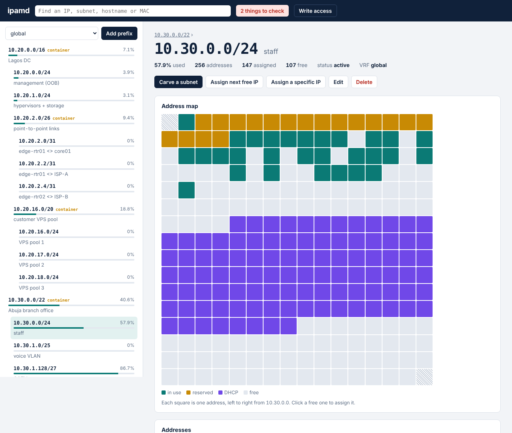

# ipamd

IP address management that a small team will actually keep up to date. A prefix tree with utilization, "give me the next free /26" and "give me the next free IP" as single API calls, an address map where every square is one IP, VRFs for overlapping customer space, and an audit log of who changed what. FastAPI + SQLite, one container.



## Why

Every network I've seen tracks addresses in a spreadsheet, and every spreadsheet is wrong within a month. Someone grabs `.50` because "it looked free", a printer and a camera end up with the same IP, and nobody knows what `10.20.4.0/24` was for.

NetBox fixes that, but it's a big Django install with a lot to learn. For a hosting company or an office with a few hundred subnets, I wanted the parts that stop the mistakes: **the tool hands out addresses, so nobody guesses**, it flags the conflicts, and it has an API so provisioning scripts can call it instead of a person.

## What it does

- **Prefix tree**: add `10.20.0.0/16`, then subnets inside it. Nesting is worked out from the addresses, with no parent field to maintain. Each prefix shows **utilization**: by child prefixes for containers, by assigned addresses for leaf subnets.
- **Carve a subnet**: `POST /api/prefixes/{id}/allocate {"prefix_length": 26}` returns the next free /26. It uses the **smallest gap that fits** first, so a /26 doesn't break into the only free /22 you have.
- **Next free IP**: `POST /api/addresses {"prefix_id": 12, "hostname": "vps-0042"}` assigns the lowest free host. `skip_first: 10` keeps the bottom of the range for gateways and switches.
- **Address map**: a /24 as a 16×16 grid, coloured by in use / reserved / DHCP / free. Click a free square to assign it.
- **Guard rails**: rejects `10.20.1.5/24` with *"has host bits set, did you mean 10.20.1.0/24?"*; won't assign the network or broadcast address (but knows /31s and /32s have neither); no duplicates; won't delete a prefix that still has subnets unless forced.
- **VRFs**: the same `192.168.1.0/24` can exist once per customer.
- **IPv4 and IPv6**, kept strictly apart (a `::/0` doesn't "contain" your IPv4 space).
- **Sites and VLANs** attached to prefixes.
- **Search** for anything: type an IP and get the most specific subnet it belongs to, or search a hostname, MAC (any format) or description.
- **Health checks**: subnets ≥90% full, the same MAC on two IPs, duplicate hostnames, addresses outside any prefix.
- **Audit log**: every create/update/delete with who (`X-Actor` header) and when.
- **CSV import/export**. Import sorts parents before children, whatever order the file is in.
- **OpenAPI docs** at `/docs`, because the API is the point.

## Run it

```
pip install git+https://github.com/GreatsLab/ipamd
IPAMD_TOKEN=change-me ipamd --host 0.0.0.0 --port 8000
python examples/seed.py http://localhost:8000 change-me     # optional: a realistic example network
```

or

```
docker build -t ipamd .
docker run -d -p 8000:8000 -e IPAMD_TOKEN=change-me -v ipamd:/data ipamd
```

Reads are open; writes need `Authorization: Bearer $IPAMD_TOKEN` (the UI has a "Write access" button). No token set = open, for a lab.

## API in one minute

```
# a site block, carved into a subnet, then an address in it
curl -X POST localhost:8000/api/prefixes -H "Authorization: Bearer $T" \
  -H 'Content-Type: application/json' -d '{"cidr":"10.20.0.0/16","status":"container","description":"Lagos DC"}'
# -> {"id": 1, ...}

curl -X POST localhost:8000/api/prefixes/1/allocate -H "Authorization: Bearer $T" \
  -H 'Content-Type: application/json' -d '{"prefix_length":24,"description":"VPS pool 4"}'
# -> {"id": 7, "cidr": "10.20.19.0/24", ...}

curl -X POST localhost:8000/api/addresses -H "Authorization: Bearer $T" -H 'X-Actor: provisioner' \
  -H 'Content-Type: application/json' -d '{"prefix_id":7,"hostname":"vps-0042","skip_first":1}'
# -> {"ip": "10.20.19.2", ...}

curl 'localhost:8000/api/search?q=10.20.19.2'
curl localhost:8000/api/health
```

## How it's built

```
ipamd/db.py     SQLite schema (WAL, foreign keys), one connection per thread, explicit transactions
ipamd/core.py   the rules: nesting, utilization, free-space maths, allocation, validation, health, audit
ipamd/app.py    FastAPI routes + pydantic models, errors as JSON with the right status (400/404/409)
ipamd/web/      the UI: no framework, one JS file
```

Addresses are stored as 16-byte big-endian keys (IPv4 mapped into `::ffff:0:0/96`), so "everything inside this prefix" is an indexed `BETWEEN`, and byte order equals numeric order for both families.

## Tests

```
pip install -e ".[test]" && pytest
```

17 tests: tree depth and utilization, host-bit hints, VRF isolation, subnet allocation order (including "smallest gap first"), network/broadcast protection, /31 links, IPv6 and family separation, delete guards, search by IP / hostname / MAC, health checks, audit log, the token, CSV import order, JSON error codes. CI runs them on Python 3.10, 3.12 and 3.13, then builds the Docker image, seeds it through the API and reads the health report.

## Bugs I hit while building it

- **The helpful error never showed.** `IPAMError` subclasses `ValueError`, and I raised it inside an `except ValueError` block, so it got caught and replaced by the plain message. That's now covered by a test.
- **`::/0` swallowed IPv4.** IPv4 keys live inside the IPv6 key space, so an IPv6 "everything" prefix contained every IPv4 address until every containment query filtered by family.
- **SQLite won't run `executescript` or change `journal_mode` inside a transaction.** Schema setup now runs before the first transaction.
- **A DHCP pool was 100 identical rows** in the address table. Consecutive anonymous entries now collapse into one range.

## Not done yet

- Ping/ARP sweep to find addresses in use that ipamd doesn't know about
- DHCP lease import (ISC Kea, MikroTik)
- LDAP / OIDC login instead of a shared token

## License

MIT
